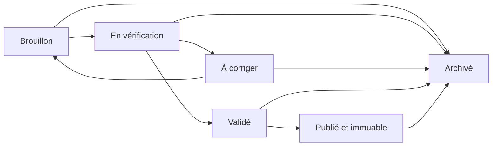

# Backend pédagogique — persistance et cycle de vie

## Périmètre

Cette architecture persiste les ressources `@elima/pedagogy` sans modifier `quiz_*` ni `learning_*`. Elle ne publie encore aucun contenu dans Elima Révision, n’appelle aucun fournisseur IA et n’ajoute aucune interface utilisateur.

La migration canonique est `supabase/migrations/20261010120000_pedagogical_authoring_backend.sql`. Elle est additive et n’est pas appliquée automatiquement à une base distante.

## Modèle de données

| Table | Responsabilité |
|---|---|
| `pedagogical_resources` | Identité éditable, tenant, auteur et métadonnées indexées. |
| `pedagogical_resource_versions` | Document public versionné, checksum SHA-256 et verrou optimiste. |
| `pedagogical_resource_version_secrets` | Corrigés et grilles privés, séparés physiquement du document public. |
| `pedagogical_resource_reviews` | Contrôles automatiques et décisions humaines, liés à une version précise. |
| `pedagogical_publications` | Publication d’une version immuable sur un canal donné. |
| `pedagogical_assignments` | Cible classe, groupe futur ou élève, dates et politique de corrigé. |
| `pedagogical_resource_events` | Journal append-only des opérations métier. |

`current_version_id` pointe vers la version de travail courante. Une nouvelle édition après publication crée une nouvelle version avec `parent_version_id`; elle ne modifie jamais la version publiée.

## Cycle de vie

Une validation automatique réussie est nécessaire avant l’approbation humaine. Une validation n’est jamais transférée à une version dérivée. Par défaut, l’auteur enseignant ne peut pas réaliser lui-même la décision humaine sur sa version.

## Concurrence et immutabilité

- `lock_version` est envoyé avec toute mise à jour de brouillon.
- `update_pedagogical_draft` réalise la comparaison et l’écriture dans une transaction.
- Un conflit retourne `409 pedagogical_version_conflict`.
- Les fonctions transactionnelles créent les agrégats et publient une version.
- Les triggers `pedagogical_versions_immutable` et `pedagogical_secrets_immutable` interdisent les modifications et suppressions après publication.
- Le checksum porte sur le bundle canonique public/privé validé.

## Services

`apps/api/server/pedagogy/service.mjs` contient la logique testable indépendamment de HTTP et de Supabase. Le dépôt `supabaseRepository.mjs` adapte cette logique au client administrateur. `authorization.mjs` centralise les erreurs et contrôles tenant/rôle. `lifecycle.mjs` définit la machine à états.

Les opérations disponibles sont : création, liste filtrée/paginée, consultation, mise à jour de brouillon, création/historique des versions, soumission, validation automatique, décision humaine, publication, affectation et archivage.

## API

Toutes les routes exigent un bearer token valide et une membership active `TEACHER`, `SCHOOL_ADMIN` ou `SUPER_ADMIN`.

| Route | Méthodes | Opérations |
|---|---|---|
| `/api/pedagogical-resources` | `GET`, `POST` | Liste/consultation; `create`, `update`, `archive`. |
| `/api/pedagogical-versions` | `GET`, `POST` | Historique et consultation d’une version par `versionId`; `create`, `submit`. |
| `/api/pedagogical-validation` | `GET`, `POST` | Résultats; `run`, `decide`. |
| `/api/pedagogical-publications` | `POST` | `publish`, `assign`. |

Les listes acceptent `limit`, `offset`, `subject`, `level`, `resourceType`, `state` et `search`. Une consultation générique renvoie la projection élève sans secrets. `includePrivate=true` exige le droit d’édition et renvoie la projection enseignant.

Codes d’erreur stables principaux :

- `400 invalid_request`;
- `401 authentication_required`;
- `403 pedagogical_access_denied`, `pedagogical_edit_denied`, `class_assignment_denied`;
- `404 pedagogical_resource_not_found` et variantes;
- `409 pedagogical_version_conflict`, `invalid_pedagogical_state`, `immutable_pedagogical_version`;
- `422 pedagogical_validation_failed` avec erreurs et avertissements `@elima/pedagogy`;
- `503 pedagogical_storage_unavailable` sans détail fournisseur sensible.

## Autorisation et RLS

Le client Supabase `service_role` contourne RLS par nature : chaque opération serveur résout donc d’abord une membership active et compare explicitement `school_id`. Les enseignants modifient leurs propres ressources; les administrateurs du tenant peuvent gérer celles de l’établissement.

Pour une classe, l’autorisation accepte une relation correspondante dans `class_teachers` ou `teacher_subject_classes`, avec le sujet lorsqu’un `subject_id` est rattaché. Cette règle de transition est centralisée dans le service sans modifier les tables historiques. La cible doit aussi appartenir au même établissement.

Les policies RLS offrent une défense supplémentaire aux clients authentifiés. La table de secrets n’accorde aucun droit direct à `authenticated`; son accès reste serveur. Les ressources sont `private` par défaut et aucun parcours élève n’est activé dans cette phase.

## Extensions futures

Une génération IA pourra appeler le service `createResource` avec un bundle brouillon déjà conforme au contrat canonique. Les jobs, prompts, appels Azure et quotas restent hors de cette phase. Une future projection Révision partira exclusivement d’une `pedagogical_publication` et enregistrera les identifiants publication/version; aucune écriture `learning_*` n’existe aujourd’hui.

